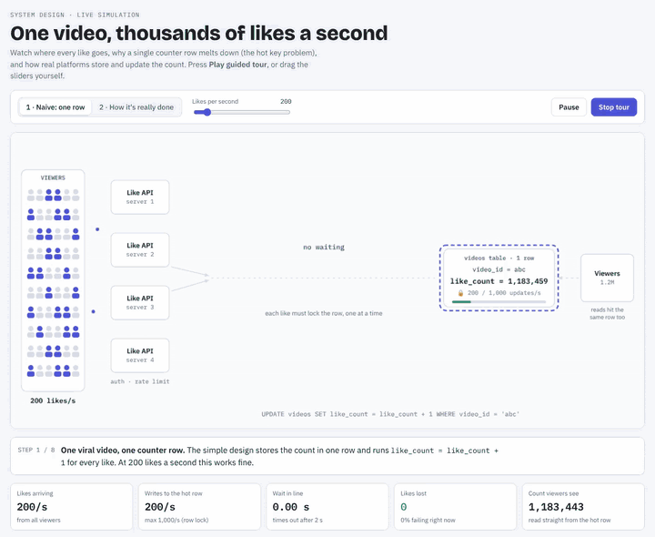

# Let's Learn

System design and data engineering concepts explained simply, with diagrams, runnable SQL and interactive simulations.
Each note answers one real question ("how does a video count millions of likes?") end to end, then ends with an interview cheat sheet.

## System design

| Note | What you'll learn |
|---|---|
| [How a video gets millions of likes](system-design/how-like-counts-work.md) | Like records vs counters, hot keys, event logs, batching, sharded counters, caching and nightly reconciliation |
| [How ticket sites stop two people booking the same seat](system-design/how-seat-booking-works.md) | Race conditions, conditional updates, row locks and deadlocks, constraints, seat holds, virtual waiting rooms |

**Simulation:** [▶️ video (MP4)](system-design/likes-simulation/likes-simulation.mp4) · [interactive version](system-design/likes-simulation/index.html):
download `index.html` and open it in a browser, then drag *Likes per second* from 100 to 50,000.

## Visual notes

| Note | Topic |
|---|---|
| [AWS services](AWS%20services.gif) | An animated map of core AWS services and what each one is for |
| [Delta tables](Delta%20Tables.png) | How Delta Lake tables add transactions, versioning and time travel on top of Parquet files |

## Related projects

The ideas here are used in my projects:
[Event Management Database](https://github.com/Inchara-Adigante/Event-management-DB) (row locks, constraints, waitlists) and
[ShopSense AI](https://github.com/Inchara-Adigante/Shopsense-AI) (streaming with watermarks, exactly-once sinks).
