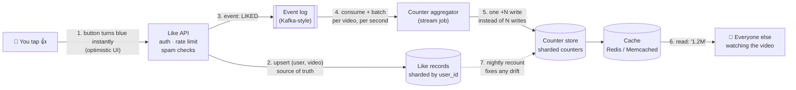

# How a video gets millions of likes: the mechanism

A viral video can collect thousands of likes **every second**. When you tap 👍, the button turns blue right away, the count goes up by one, and if you refresh the page your like is still there. Behind that sit a few simple ideas, combined carefully.

> YouTube, Instagram and X don't publish their exact internals. This is the **standard design** used for counters at this scale (and the way system-design interviews expect you to explain it). The building blocks are real and widely used.

---

## 1. The key insight: it's really two different problems

| Question | Example | What it needs |
|---|---|---|
| **Did *I* like this video?** | The 👍 button is blue for you | **Exact**, per user. You must never see your own like disappear. |
| **How many people liked it?** | "1.2M" under the video | **Approximate is fine.** Nobody notices if it says 1,204,311 vs 1,204,377 for a few seconds. |

So the system stores **two things**:
1. **Like records**, the source of truth: one row per `(user_id, video_id)`.
2. **A counter**, a fast summary: one number per `video_id`, allowed to lag slightly behind.

Almost every trick below comes from treating these two differently.

---

## 2. Why the naive way breaks

The obvious approach:

```sql
UPDATE videos SET like_count = like_count + 1 WHERE video_id = 'abc';
```

Every like for the same video updates **the same row**. To keep the number correct, the database locks that row for each update, so the updates happen **one at a time**. A single hot row handles roughly a few hundred to a few thousand updates a second. A viral video needs more, so requests queue up, time out, and the whole database slows down for everyone.

This is the **hot key** problem: one popular item gets far more traffic than any single machine or row can handle.

---

## 3. The full journey of one like



### Step 1: the button changes before the server answers
The app turns the button blue and adds 1 to the number **on your phone immediately**. This is called *optimistic UI*. The request goes to the server in the background. If it fails, the app quietly undoes it.

### Step 2: save the like record (the part that must be exact)
The server writes one row:

| user_id | video_id | state | updated_at |
|---|---|---|---|
| u_829 | abc | LIKED | 2026-10-24 19:02:11 |

- The key is `(user_id, video_id)`, so **one person can only have one like per video**. Tapping twice, a network retry, or a double-click all update the *same* row. This is **idempotency**.
- The table is **sharded by `user_id`**: split across many machines by user. Millions of different users liking the same video spread across *all* the shards, so there's no hot key here.
- This is what powers "your button is blue" when you come back next week.

### Step 3: publish an event
Instead of updating the counter directly, the server appends an event to a log such as Apache Kafka:

```json
{"event": "LIKED", "user_id": "u_829", "video_id": "abc", "ts": "2026-10-24T19:02:11Z"}
```

The log is cheap to write to, very fast, and keeps events in order. To make sure the like record and the event can't get out of sync if a server crashes in between, systems use the **outbox pattern** (write the event into the same database transaction, then forward it) or **change data capture** (stream every change from the database's own log).

### Step 4: aggregate, so that a million writes become a few thousand
A stream-processing job reads the events and **adds them up in memory**, per video, for a short window (say one second):

```
video abc: +4,812 likes, -37 unlikes in the last second → net +4,775
```

Then it does **one** write: `count += 4,775`. That's thousands of times fewer writes to the hot counter. The cost is that the count lags by about a second, which nobody can see.

### Step 5: sharded counters, splitting the hot number itself
Even batched writes to one row can be too many for the most viral videos. So the counter is split into many sub-counters:

```
like_count:abc:0 = 301,220
like_count:abc:1 = 299,874
...
like_count:abc:63 = 300,512
```

- **Write:** add to a *random* sub-counter, so writes spread over 64 rows (or machines) instead of 1.
- **Read:** add all 64 up. Then cache the total, so the sum isn't recomputed for every viewer.

### Step 6: reading the count
Millions of people *watching* a viral video read the count far more often than people *like* it. Reads go to a **cache** (like Redis or Memcached) that's refreshed every few seconds, not to the database. Then the number is rounded for display: **1,204,311 → "1.2M"**. Rounding also hides the small lag completely.

### Step 7: reconciliation, the safety net
Counters can drift: a crashed aggregator, a replayed event, a bug. Periodically (for example nightly), a batch job **recounts from the source of truth**:

```sql
SELECT video_id, COUNT(*) FROM like_records WHERE state = 'LIKED' GROUP BY video_id;
```

and corrects the counter. This is why the **like records** are the truth and the counter is just a fast copy.

---

## 4. The tricky cases

| Situation | What goes wrong | How it's handled |
|---|---|---|
| Double tap / network retry | Like counted twice | Like record keyed on `(user_id, video_id)`; only a real *state change* (not liked → liked) emits an event |
| Like then quickly unlike | Events processed out of order → wrong final state | Events are partitioned by `(user_id, video_id)` in the log, so one user's actions on one video stay in order. Store the *state* (LIKED / NOT_LIKED) with a timestamp, not just +1/−1 |
| Aggregator crashes mid-batch | Batch applied twice or lost | Checkpoint the log position together with the counter update, or make the update idempotent by storing which events were applied (**exactly-once processing**) |
| Bots / like farms | Fake likes inflate the count | Spam checks at the API, then later fraud detection. **This is why counts sometimes go *down*.** |
| Video goes viral suddenly | One counter becomes a hot key | Add more counter shards for that video automatically |
| Region outage | Likes from that region delayed | Each region keeps accepting likes and syncs later. Counts converge (*eventual consistency*) |

---

## 5. The trade-off in one sentence

**The system gives up a tiny bit of accuracy and freshness on the *total* (a second of lag, rounding) to get speed and scale, while keeping *your own* like exact and permanent.**

This is the classic **consistency vs availability/latency** trade-off (CAP / PACELC). Likes choose *eventual consistency* for the total because it's harmless. A bank balance would make the opposite choice.

---

## 6. It's the same pattern as data engineering

| Like system | Data engineering concept |
|---|---|
| Event log of LIKED / UNLIKED | Kafka / Kinesis topic |
| Aggregator adding up per second | Spark Structured Streaming / Flink windowed aggregation |
| Ignoring duplicate taps and retries | Deduplication + idempotent sink (`INSERT OR IGNORE` on a key) |
| Nightly recount | Batch reconciliation job comparing to the source of truth |
| Count lags by a second | Eventual consistency / watermark-based processing |
| Like records vs counter | Raw/clean data vs curated aggregate table |

My [ShopSense AI](https://github.com/Inchara-Adigante/Shopsense-AI) streaming pipeline uses the same ideas: a watermark, deduplication and an exactly-once sink so that **no event is lost or counted twice**, even after a crash.

---

## 7. Cheat sheet (for interviews)

1. **Separate** the per-user like record (exact, sharded by user) from the total count (approximate, cached).
2. **Idempotent** writes keyed on `(user_id, video_id)`: retries and double taps are harmless.
3. **Event log** decouples the click from the counting.
4. **Batch** in a stream job: N likes → one `+N` write.
5. **Shard the counter** for hot videos: write to a random shard, sum on read.
6. **Cache** reads and **round** for display.
7. **Reconcile** from the source of truth to fix drift.
8. **Optimistic UI** makes it feel instant.

---

## 8. Try it yourself: a tiny simulation in Python

```python
import random
from collections import defaultdict

SHARDS = 8
like_records = {}                       # (user_id, video_id) -> True/False   (source of truth)
counter_shards = defaultdict(int)       # (video_id, shard) -> partial count
event_log = []                          # what Kafka would hold


def tap_like(user_id, video_id, liked=True):
    """API: idempotent - only a real change emits an event."""
    if like_records.get((user_id, video_id), False) == liked:
        return                                        # retry / double tap: nothing to do
    like_records[(user_id, video_id)] = liked
    event_log.append((video_id, +1 if liked else -1))


def run_aggregator():
    """Stream job: add up events per video, then one write per video to a random shard."""
    batch = defaultdict(int)
    while event_log:
        video_id, delta = event_log.pop(0)
        batch[video_id] += delta
    for video_id, net in batch.items():
        counter_shards[(video_id, random.randrange(SHARDS))] += net


def read_count(video_id):
    return sum(counter_shards[(video_id, s)] for s in range(SHARDS))


def display(n):
    return f"{n / 1e6:.1f}M" if n >= 1e6 else f"{n / 1e3:.1f}K" if n >= 1e3 else str(n)


# 50,000 users like the video; 10% of them double-tap; 2,000 change their mind
for u in range(50_000):
    tap_like(u, "abc")
    if random.random() < 0.10:
        tap_like(u, "abc")                    # duplicate tap: ignored
for u in range(2_000):
    tap_like(u, "abc", liked=False)           # unlike

run_aggregator()
truth = sum(1 for (u, v), liked in like_records.items() if v == "abc" and liked)
print("counter:", read_count("abc"), "| recount from source of truth:", truth,
      "| shown as:", display(read_count("abc")))
# counter: 48000 | recount from source of truth: 48000 | shown as: 48.0K
```
