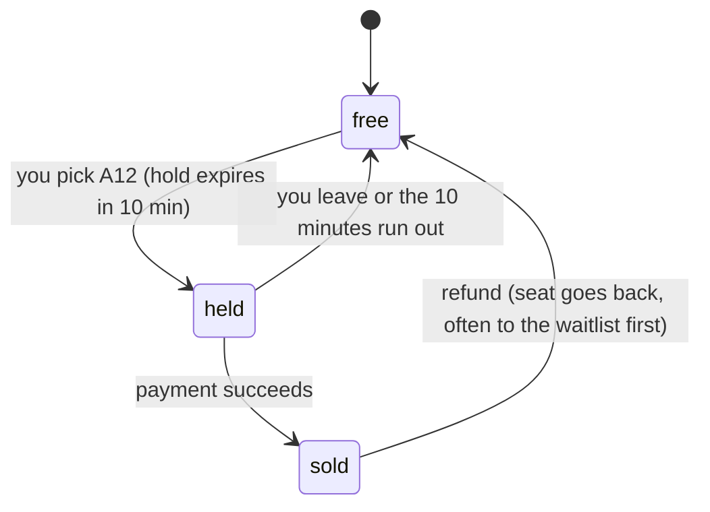

# How ticket sites stop two people booking the same seat

A concert goes on sale. 50,000 people press **Buy** in the same minute for 5,000 seats. Seat **A12** gets clicked by
200 people at the same moment, and exactly one of them must get it. How does a site like Ticketmaster or BookMyShow
make that work?

> These companies don't publish their exact internals. This is the standard design, and the database parts are
> exactly what I built and tested in my [Event Management Database](https://github.com/Inchara-Adigante/Event-management-DB).

---

## 1. The bug everyone starts with: check, then write

```python
seat = db.query("SELECT status FROM seats WHERE id = 'A12'")
if seat.status == "free":                 # two buyers both see "free" here...
    db.execute("UPDATE seats SET status = 'sold', buyer = %s WHERE id = 'A12'", me)   # ...and both "win"
```

Between the `SELECT` and the `UPDATE` there are a few milliseconds. Two requests running at the same time both read
`free`, both write `sold`, and the seat is sold twice. This is called a **race condition** (or *check-then-act*).
It never shows up when you test alone, and always shows up on launch day.

---

## 2. Four ways to fix it

### Fix A: make the check and the write one step (conditional update)
```sql
UPDATE seats SET status = 'sold', buyer_id = 42
 WHERE id = 'A12' AND status = 'free';        -- returns "1 row updated" to exactly one buyer
```
The database applies updates to a row one at a time. The first buyer changes it; for everyone else the
`WHERE status = 'free'` no longer matches, and they get "0 rows updated" → *"Sorry, this seat was just taken."*
Simple and very fast. Best for one seat, one counter.

### Fix B: lock the row, then decide (pessimistic locking)
```sql
BEGIN;
SELECT * FROM ticket_types WHERE id = 87 FOR UPDATE;   -- other buyers wait here
-- check sales window, per-order limit, promo code, availability...
UPDATE ticket_types SET quantity_sold = quantity_sold + 2 WHERE id = 87;
INSERT INTO tickets ...;
COMMIT;                                                 -- the next buyer goes in
```
Use this when the decision needs several checks. **Rule:** if you lock several rows, always lock them in the same
order (for example by id). Otherwise buyer 1 holds row 5 and waits for row 7, while buyer 2 holds row 7 and waits
for row 5: a **deadlock**.

### Fix C: let the database refuse bad data (constraints)
```sql
ALTER TABLE ticket_types ADD CHECK (quantity_sold <= quantity_total);   -- can never be oversold
CREATE UNIQUE INDEX one_ticket_per_seat ON tickets (event_id, seat_id); -- a seat can't be sold twice
```
Even if application code has a bug, the database rejects the second sale. Use this **as well as** A or B: it's
the safety net.

### Fix D: version numbers (optimistic locking)
```sql
UPDATE seats SET status = 'sold', version = version + 1
 WHERE id = 'A12' AND version = 7;     -- 7 = the version I read; fails if anyone changed it since
```
No waiting: if someone changed the row in between, you retry. Good when conflicts are rare (editing a profile),
bad for a hot on-sale where everyone conflicts.

---

## 3. Holding a seat while you pay

Nobody pays in a millisecond. Real sites **hold** the seat for a few minutes:



```sql
UPDATE seats SET status = 'held', held_by = 42, hold_expires_at = now() + interval '10 minutes'
 WHERE id = 'A12' AND (status = 'free' OR (status = 'held' AND hold_expires_at < now()));
```
The second condition lets an **expired** hold be taken over, so abandoned carts don't block seats forever.
My Event DB does the same for the waitlist: freed seats are offered to the next person in line and **held for 24
hours** before anyone else can buy them.

---

## 4. When 50,000 people arrive in one minute

Locks make the answer correct, but buyers of the same tickets queue on the same row: a **hot key**, like the hot
counter in my [likes simulation](how-like-counts-work.md).

I measured it in my Event DB (16 concurrent buyers):

| Scenario | Checkouts per second | Oversold |
|---|---:|---:|
| Everyone buys the same ticket type (one hot row) | 644 | 0 |
| Buyers spread over 16 ticket types | 2,123 | 0 |

Correctness never changes with load; only speed does. For really big on-sales, sites add:

1. **A virtual waiting room.** Buyers get a place in a queue and are let in at a rate the database can handle
   ("You are number 18,234 in line").
2. **Split inventory.** Seats are divided into sections, each its own row or shard, so buyers don't all wait on one lock.
3. **Fast holds in memory.** Short-lived holds go in Redis (`SET seat:A12 user42 NX EX 600` succeeds for one
   buyer only); the final sale is still written to the database with its constraints.
4. **Idempotent payments.** Each payment has a unique id, so a retried or duplicated payment webhook can't charge
   or sell twice.

---

## 5. Cheat sheet (for interviews)

1. The bug is **check-then-act**: two requests both see "free".
2. Fix it by making check and write **atomic**: a conditional `UPDATE`, or `SELECT ... FOR UPDATE` in a transaction.
3. Lock several rows **in a fixed order** to avoid deadlocks.
4. Add **constraints** (`CHECK`, `UNIQUE`) as the safety net.
5. **Hold** seats with an expiry while people pay.
6. At huge scale, a **waiting room** and **split inventory** spread the load; the database still has the final say.
7. **Test it with real concurrency:** in my project, 40 threads race for 25 seats, and exactly 25 succeed every run.
